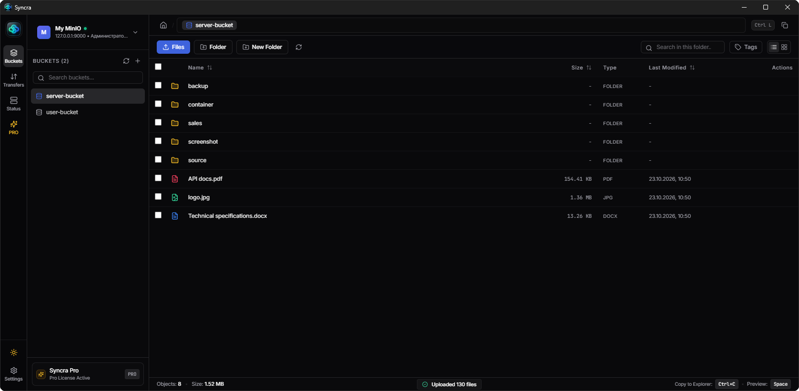
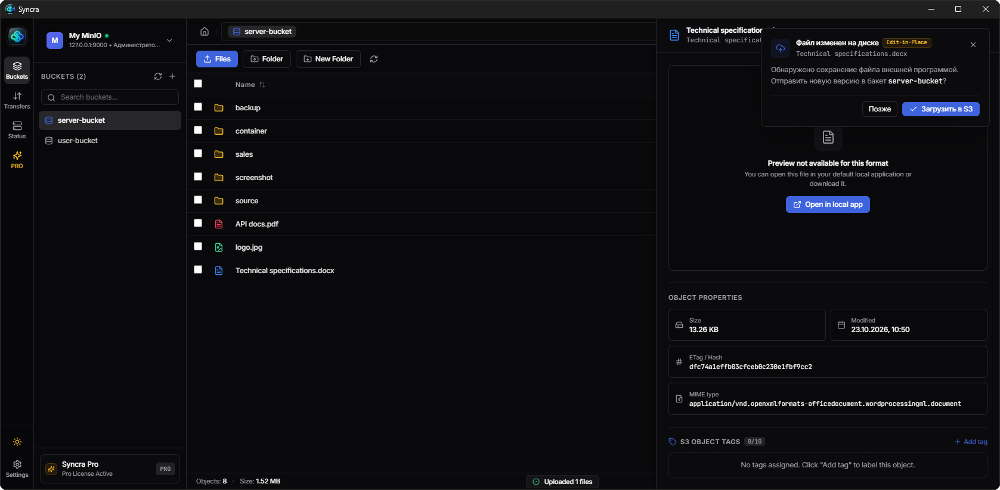
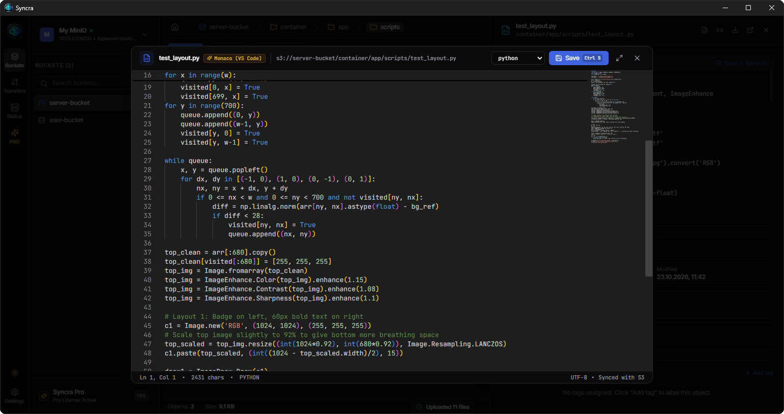
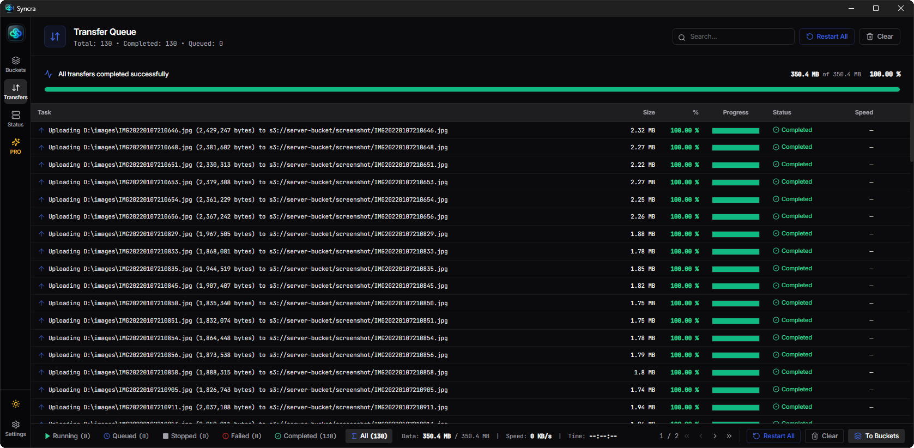
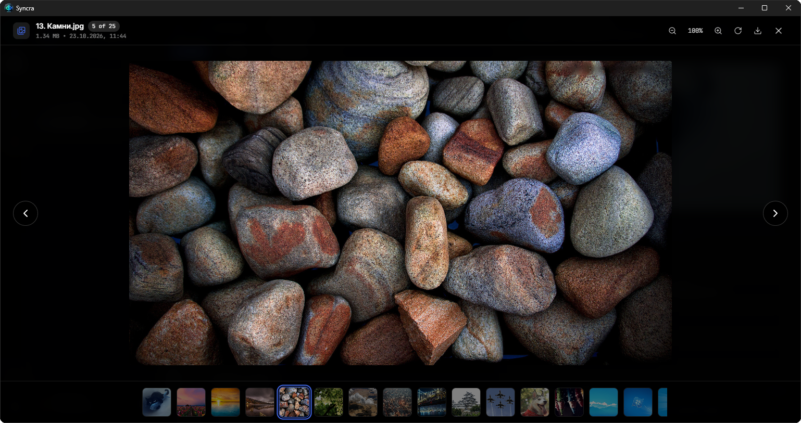
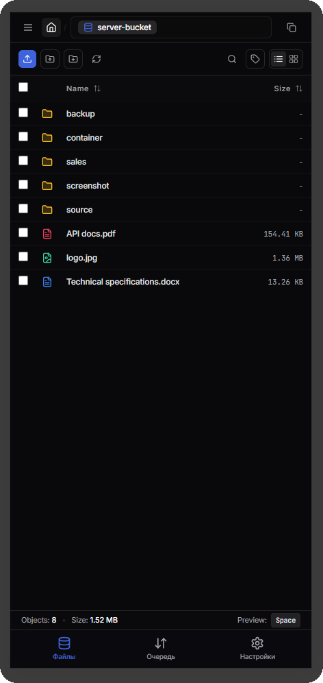

<div align="center">

# ⚡ Syncra — Modern S3 & MinIO Desktop Client

**The next-generation GUI client for MinIO, AWS S3, Ceph, Yandex Object Storage, and all S3-compatible storages.**  
*A fast, keyboard-driven alternative to Cyberduck, WinSCP, and clumsy web consoles.*

[](https://github.com/Chistogov/syncra/releases/latest)
[](https://github.com/Chistogov/syncra/releases/latest)
[](LICENSE)
[](https://github.com/Chistogov/syncra/stargazers)

<br/>

🇷🇺 **[Читать на русском языке (README_RU.md)](README_RU.md)** • 🇺🇸 **English**

<br/>

<!-- HERO CTA DOWNLOAD BUTTONS -->
<p align="center">
  <a href="https://github.com/Chistogov/syncra/releases/download/v1.0.0/Syncra.Setup.1.0.0.exe">
    
  </a>
  &nbsp;&nbsp;
  <a href="https://github.com/Chistogov/syncra/releases/download/v1.0.0/Syncra.1.0.0.exe">
    
  </a>
</p>
<p><sub>✨ Includes instant 14-day fully-featured Pro trial. Zero registration required.</sub></p>

<br/>



</div>

---

## 💡 Why Syncra?

Most S3 tools were built over a decade ago. They are slow, dated, and force you to download files manually just to make a one-line change.

**Syncra redefines cloud storage management with modern desktop-first workflows:**

---

### 🔥 1. Edit-in-Place (Auto-sync `Ctrl + S` directly to S3)
Open Word (`.docx`), Excel (`.xlsx`), Photoshop, or text files directly in your native desktop apps. The moment you press **`Ctrl + S`**, Syncra detects the change and automatically uploads the updated version back to your S3 bucket.

<p align="center">
  
</p>

---

### 💻 2. In-Storage Monaco Code Editor (VS Code Engine)
Edit JSON, YAML, SQL, Shell scripts, and Python files directly inside your cloud bucket. Features syntax highlighting, line numbers, and a code minimap powered by Monaco Editor.

<p align="center">
  
</p>

---

### 🚀 3. High-Performance Transfer Queue Manager
Massive background uploads and downloads with real-time speed monitoring, retry handlers, and progress bars. Easily handle thousands of files without UI freezes.

<p align="center">
  
</p>

---

### ⚡ 4. Instant Quick Look & Media Lightbox
Press **`Space`** to preview PDFs, high-res photos, 4K videos, and code without downloading them to disk. Includes an interactive multi-image gallery with pan and zoom.

<p align="center">
  
</p>

---

### 📱 5. Embedded Local Web Server (Mobile Access)
Access and browse your cloud storage from smartphones or tablets over your local Wi-Fi. Zero app installation required — simply connect via browser with secure 6-digit PIN protection.

<p align="center">
  
</p>

---

## 🥊 How Syncra Compares

| Capability | Syncra | Cyberduck | WinSCP | AWS Web Console |
| :--- | :---: | :---: | :---: | :---: |
| **Modern Dark/Light UI** | **✅ Slick (Plane.so style)** | ❌ Outdated | ❌ Legacy 2000s | ⚠️ Clunky |
| **Edit-in-Place (`Ctrl+S` auto-save)** | **✅ Instant to S3** | ⚠️ Unstable lock | ❌ Download only | ❌ Download only |
| **Integrated Code Editor (Monaco)** | **✅ Built-in (VS Code)** | ❌ External only | ⚠️ Basic Notepad | ❌ No |
| **MinIO IAM & Visual mc Admin** | **✅ Built-in GUI** | ❌ None | ❌ None | ❌ None |
| **Native Windows Copy-Paste** | **✅ `Ctrl+C` → `Ctrl+V`** | ❌ No | ❌ No | ❌ No |
| **Fast Media & PDF Preview** | **✅ Spacebar Quick Look** | ⚠️ Slow QuickLook | ❌ No | ❌ Limited |
| **Local WiFi Mobile Access** | **✅ Built-in (PIN)** | ❌ No | ❌ No | ❌ No |

---

## 🌟 Key Features (Community Edition)

* **Multi-Cloud S3 Profiles:** Connect to MinIO (local & remote), AWS S3, Ceph RADOS Gateway, Yandex Object Storage, Wasabi, and Cloudflare R2.
* **Dual Addressing Modes:** Full support for Path-Style (`s3ForcePathStyle`) and Virtual-Hosted routing.
* **Connection Diagnostics:** Instant ping and credential verification with `Test Connection`.
* **Flexible Views:** Switch effortlessly between a dense detail Table and visual Grid cards.
* **S3 Object Tagging:** View, manage, batch-tag, and filter objects using `AND`, `OR`, and `EXACT` boolean logic.
* **Drag & Drop:** Directly drag files and folders from Windows Explorer into buckets.
* **Presigned URLs:** Generate temporary public download links with custom expiration (15m, 1h, 24h, 7d).
* **Native Clipboard Integration:** Copy objects in Syncra (`Ctrl + C`) and paste directly into Windows Explorer (`Ctrl + V`).

---

## 📊 Community vs Pro Edition

Syncra is built on an **Open-Core** model:

| Feature | Community Edition (Open Source) | Pro Edition (Official Release) |
| :--- | :---: | :---: |
| **License** | Free Forever (MIT) | Commercial / Lifetime ($29) |
| **Active S3 Server Profiles** | Up to 3 servers | **Unlimited servers** |
| **Full File & Bucket Operations** | ✅ Full access | ✅ Full access |
| **Quick Look & PDF Viewer** | ✅ Full access | ✅ Full access |
| **S3 Object Tagging & Filtering** | ✅ Full access | ✅ Full access |
| **Embedded Mobile Web Server** | ✅ Full access | ✅ Full access |
| **Edit-in-Place (Auto-sync `Ctrl+S`)** | ❌ Pro feature | **✅ Full access** |
| **In-Storage Monaco Code Editor** | View-only | **✅ Full edit & save** |
| **Visual MinIO Admin Panel (`mc` GUI)** | ❌ Pro feature | **✅ Full GUI Admin** |
| **Hardware-Locked Offline Activation** | — | **✅ 1-Click HWID Key** |

> 🎁 **Every official binary includes a 14-day fully unlocked Pro trial with zero feature restrictions!**

---

## 📦 Download Official Binaries

Skip building from source and download ready-to-run Windows binaries:

* **[Download Syncra Setup v1.0.0 (Windows Installer)](https://github.com/Chistogov/syncra/releases/download/v1.0.0/Syncra.Setup.1.0.0.exe)**
* **[Download Syncra Portable v1.0.0 (.exe without installation)](https://github.com/Chistogov/syncra/releases/download/v1.0.0/Syncra.1.0.0.exe)**

---

## 🚀 Quick Start (Run from Source)

### Prerequisites
* [Node.js](https://nodejs.org/) (v18 or later)
* `npm` or `yarn`

```bash
# 1. Clone the repository
git clone https://github.com/Chistogov/syncra.git
cd syncra

# 2. Install dependencies
npm install

# 3. Launch in development mode with HMR
npm run dev

# 4. Build desktop release
npm run build
```

---

## 🛡 Security & Privacy

* **Local-First Credentials:** All AWS/MinIO access keys, secrets, and endpoint configurations are stored locally on your machine using OS-level secure credential storage.
* **Zero Telemetry on Bucket Data:** Syncra connects directly to your S3 endpoints. Your data, files, and credentials are never transmitted through external proxy servers.

---

## 📄 License

The Community Edition of Syncra is open-source software licensed under the **[MIT License](LICENSE)**.
