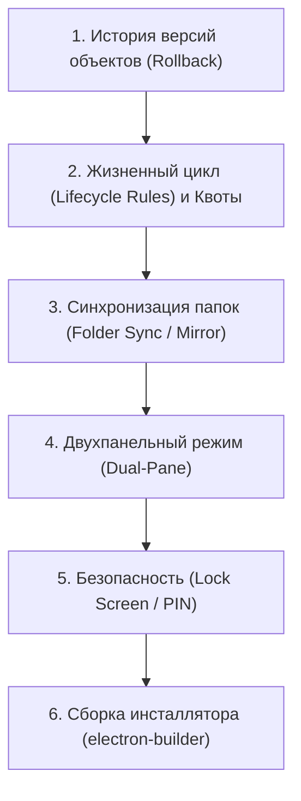

# План оставшихся задач (TODO) — S3 Desktop Explorer (MinIO Studio)

Данный документ содержит детальное описание функционала, запланированного по [Техническому заданию (TECH_SPEC.md)](file:///d:/WORK/llm_projects/s3_browser/TECH_SPEC.md) и [Плану монетизации (MONETIZATION_PLAN.md)](file:///d:/WORK/llm_projects/s3_browser/MONETIZATION_PLAN.md), но ещё не реализованного в кодовой базе проекта.

---

## 📋 Общий прогресс реализации

| Модуль | Статус | Приоритет | Сложность |
| :--- | :---: | :---: | :---: |
| **1. Управление жизненным циклом и квотами бакетов** | ⏳ Ожидает | Высокий | Средняя |
| **2. История версий конкретного файла и откат (Rollback)** | ⏳ Ожидает | Высокий | Средняя |
| **3. Синхронизация папок (Folder Sync / GUI для `mc mirror`)** | ⏳ Ожидает | Высокий | Высокая |
| **4. Двухпанельный режим (Total Commander style)** | ⏳ Ожидает | Средний | Высокая |
| **5. Сервисные аккаунты пользователей (Service Accounts)** | ⏳ Ожидает | Средний | Низкая |
| **6. Безопасность (Автоблокировка PIN-кодом / Экспорт профилей)** | ⏳ Ожидает | Средний | Низкая |
| **7. Сборка установщиков (`.exe` NSIS / Portable) и релизы** | ⏳ Ожидает | Высокий | Средняя |

---

## 📌 Детальное описание задач

---

### Блок 1. Расширенное управление бакетами (Bucket Lifecycle & Quotas)

#### 1.1. Правила жизненного цикла объектов (Bucket Lifecycle Rules)
- **Цель:** Настройка автоматического удаления устаревших файлов и версий или очистки незавершённых multipart-загрузок.
- **Технические детали:**
  - Использование `@aws-sdk/client-s3`: команды `GetBucketLifecycleConfigurationCommand`, `PutBucketLifecycleConfigurationCommand`, `DeleteBucketLifecycleConfigurationCommand`.
  - Модальное окно или вкладка в свойствах бакета («Жизненный цикл»).
  - Настройка правил:
    - Префикс или теги для применения правила (например, `logs/` или `temp/*`).
    - Количество дней до окончательного удаления (`ExpirationInDays`).
    - Удаление неактуальных версий файлов (`NoncurrentVersionExpiration`).
    - Автоматическая очистка зависших незавершенных multipart-загрузок (`AbortIncompleteMultipartUpload`).
- **Задачи:**
  - [ ] Создать IPC-обработчики: `s3:getBucketLifecycle`, `s3:setBucketLifecycle`, `s3:deleteBucketLifecycle`.
  - [ ] Разработать UI-компонент формы добавления/редактирования правил с таблицей активных правил и переключателем статуса.

#### 1.2. Квоты бакетов (Bucket Quotas)
- **Цель:** Ограничение максимального объема данных и числа объектов в бакете на сервере MinIO.
- **Технические детали:**
  - Использование MinIO Admin API: `mc admin bucket quota <alias>/<bucket> --size 50GiB` / `--count 10000`.
  - Типы квот: жесткая (`hard`, запрещает запись при превышении) и квота FIFO (`fifo`, удаляет старые объекты).
- **Задачи:**
  - [ ] Добавить в `minio-admin.ts` методы `getBucketQuota(profile, bucket)` и `setBucketQuota(profile, bucket, quota)`.
  - [ ] Зарегистрировать IPC-каналы `admin:getBucketQuota` и `admin:setBucketQuota`.
  - [ ] Добавить карточку квоты в раздел детальной информации о бакете с визуальным индикатором заполнения (progress-bar).

#### 1.3. Шифрование бакета по умолчанию (Default Server-Side Encryption)
- **Цель:** Принудительное шифрование всех новых объектов, сохраняемых в бакете.
- **Технические детали:**
  - Использование `GetBucketEncryptionCommand` и `PutBucketEncryptionCommand`.
  - Алгоритмы: `AES256` (SSE-S3) и `aws:kms` (SSE-KMS) с возможностью ввода KMS Key ID.
- **Задачи:**
  - [ ] Создать IPC-обработчики `s3:getBucketEncryption` и `s3:setBucketEncryption`.
  - [ ] Добавить переключатель в настройках бакета с выбором типа шифрования (Disabled, AES-256, KMS).

---

### Блок 2. История версий конкретного файла (Object Version History & Rollback)

- **Цель:** Просмотр всей истории изменений выбранного файла в версионированном бакете с возможностью скачать любую предыдущую версию или восстановить её как актуальную.
- **Технические детали:**
  - Использование `ListObjectVersionsCommand` с фильтрацией по `Prefix: objectKey`.
  - Получение версий (`VersionId`, `LastModified`, `Size`, `IsLatest`, `ETag`, `Owner`, `DeleteMarker`).
  - Восстановление версии:
    - Либо вызов `CopyObjectCommand` с указанием `CopySource: bucket/key?versionId=...` в качестве источника для создания новой актуальной версии.
    - Удаление Delete Marker для восстановления удаленного файла.
- **Задачи:**
  - [ ] Реализовать IPC-метод `s3:listObjectVersions(profile, bucket, key)` в `s3-service.ts`.
  - [ ] Реализовать IPC-метод `s3:restoreObjectVersion(profile, bucket, key, versionId)`.
  - [ ] Создать модальное окно `ObjectVersionsModal.tsx` с таблицей версий, маркерами удаления, кнопкой прямого скачивания старой версии и кнопкой «Восстановить как актуальную».
  - [ ] Добавить пункт «История версий...» в контекстное меню файла в проводнике.

---

### Блок 3. Синхронизация и зеркалирование папок (Folder Sync / GUI для `mc mirror`)

- **Цель:** Полноценный графический инструмент зеркалирования директорий (локальная папка $\leftrightarrow$ бакет).
- **Технические детали:**
  - Режимы синхронизации:
    - **Upload Mirror:** Локальная папка $\rightarrow$ S3-бакет (добавление новых и измененных файлов).
    - **Download Mirror:** S3-бакет $\rightarrow$ Локальная папка.
    - **Two-way:** Двусторонняя синхронизация с разрешением конфликтов по дате последнего изменения.
  - Опции:
    - `Remove`: удаление файлов в целевой директории, если они удалены в источнике (`--remove`).
    - `Overwrite`: перезапись только при несовпадении размера или хеша (`MD5/ETag`).
    - `Dry-run`: безопасный предварительный просмотр различий (список файлов: создать, обновить, удалить) без реальной записи.
    - Маски фильтрации (`Exclude / Include patterns`: например, `*.tmp`, `node_modules/**`, `.git/**`).
- **Задачи:**
  - [ ] Разработать движок сравнения директорий (`SyncEngine`) в Node.js процессе.
  - [ ] Создать окно/вкладку `FolderSyncModal.tsx`:
    - Выбор локальной папки и целевого бакета/префикса.
    - Выбор направления и параметров (Remove, Overwrite, Фильтры).
    - Таблица diff-результатов (Dry Run) с цветовой индикацией (зеленый — добавление, желтый — перезапись, красный — удаление).
    - Интеграция с очередью передач `TransferQueueManager` для пакетного выполнения.

---

### Блок 4. Двухпанельный режим проводника (Dual-Pane / Total Commander Style)

- **Цель:** Одновременная работа с двумя бакетами или двумя разными директориями в одном окне для быстрого копирования и перемещения.
- **Технические детали:**
  - Горизонтальный сплит-экран: левая панель (Панель 1) и правая панель (Панель 2).
  - Каждая панель независима: имеет свой селектор бакета, строку хлебных крошек, поиск и список файлов.
  - Прямое межсетевое копирование (`Server-Side Copy`):
    - Для бакетов в рамках одного S3-профиля передача выполняется на стороне сервера через `CopyObjectCommand` без прогонки трафика через локальный ПК.
    - Для разных профилей — потоковая перекачка (Stream pipe) через оперативную память.
  - Горячие клавиши: `Tab` (переключение фокуса), `F5` (копировать в соседнюю панель), `F6` (переместить), `F8` (удалить).
- **Задачи:**
  - [ ] Добавить в шапку проводника переключатель режима: «Одна панель» / «Две панели» (`Split View`).
  - [ ] Вынести состояние проводника в абстракцию `PaneState` (текущий бакет, префикс, выбранные элементы).
  - [ ] Реализовать межпанельные операции: drag-and-drop между панелями и кнопки передачи (`Копировать в правую панель`).

---

### Блок 5. Сервисные аккаунты MinIO (Service Accounts / Access Keys)

- **Цель:** Управление дополнительными сервисными ключами для пользователей MinIO (аналог AWS IAM Access Keys).
- **Технические детали:**
  - Команды CLI: `mc admin user svcacct add/list/info/edit/rm`.
  - Возможность для любого пользователя создать ограниченные сервисные токены с ограниченным сроком действия (Expiration) и собственной политикой.
- **Задачи:**
  - [ ] Добавить методы `listServiceAccounts`, `createServiceAccount`, `deleteServiceAccount` в `minio-admin.ts`.
  - [ ] Добавить в карточку пользователя MinIO подраздел «Сервисные ключи (Access Keys)».
  - [ ] Модальное окно генерации ключа с показом Secret Key (с кнопкой копирования в буфер обмена).

---

### Блок 6. Безопасность и командная работа (Security & Team Sharing)

#### 6.1. Автоблокировка приложения PIN-кодом / Мастер-паролем
- **Цель:** Защита доступа к данным при оставлении рабочего места без блокировки всей ОС.
- **Технические детали:**
  - Хранение хеша пароля (Argon2 / PBKDF2).
  - Таймер неактивности пользователя (3 мин, 5 мин, 15 мин, никогда).
  - Экран блокировки (Lock Screen) с размытием заднего фона и вводом PIN-кода.
- **Задачи:**
  - [ ] Создать хук отслеживания неактивности (`useIdleTimer`).
  - [ ] Реализовать экран блокировки `LockScreen.tsx`.
  - [ ] Добавить настройки безопасности в `SettingsModal.tsx`.

#### 6.2. Зашифрованный экспорт и импорт профилей подключений
- **Цель:** Безопасная передача готовых профилей коллегам без риска утечки ключей в открытом виде.
- **Технические детали:**
  - Экспорт выбранных профилей в файл `.s3prof`.
  - Шифрование содержимого по алгоритму `AES-256-GCM` с парольной фразой, вводимой пользователем при экспорте.
- **Задачи:**
  - [ ] Реализовать модуль криптографии профилей в `src/main`.
  - [ ] Добавить кнопки «Экспорт профилей» и «Импорт профилей» в `ProfileModal.tsx`.

---

### Блок 7. Сборка дистрибутива, инсталлятор и автообновление

- **Цель:** Подготовка коммерческих релизов для конечных пользователей под Windows.
- **Технические детали:**
  - Пакет `electron-builder`.
  - Форматы для Windows:
    - **NSIS Installer:** `.exe` установщик с ярлыками на рабочем столе и в меню «Пуск».
    - **Portable:** `.exe` файл, не требующий прав администратора и готовый к запуску с флешки.
  - Интеграция `electron-updater` для автоматической проверки обновлений с GitHub Releases.
- **Задачи:**
  - [ ] Настроить блок `build` в `package.json` (иконки `.ico`, app ID, target Windows NSIS + portable).
  - [ ] Добавить скрипт `npm run package:win` и протестировать генерацию бинарников.
  - [ ] Добавить модуль проверки обновлений в `src/main/index.ts` с показом баннера «Доступна новая версия».

---

## 🎯 Рекомендуемая очерёдность реализации

